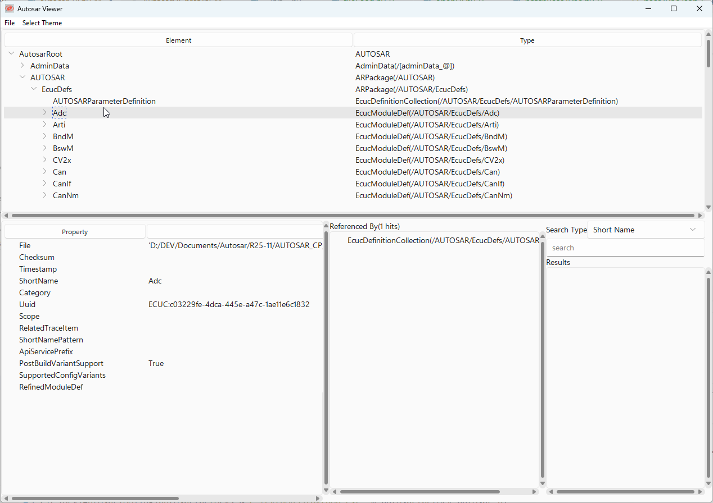

[](https://github.com/girishchandranc/autosarfactory/actions)
# Autosar Modelling Tool
AutosarFactory provides APIs to read/create/modify AUTOSAR compliant arxml files. 

- The folder `autosarfactory` contains the autosarfactory implementation for the schema of the latest AUTOSAR release. 
- The folder `autosar_releases` contains the autosarfactory implementation for previous AUTOSAR releases

## How to use
### Requirements
Python 3.10 or newer.

### Installation
- Clone the repository.
- Install the package from the repository folder:

      $ pip install .

- Import the package `autosarfactory` in your python script.

### Reading file
```python
#Read a list of files
files = ['component.arxml', 'datatypes.arxml']
root, status = autosarfactory.read(files)

#Read a list of folders
folders = ['folder1', 'folder2']
root, status = autosarfactory.read(folders)

```
The read method processes the input files/folders and return the root node(with merged info of all the files) and a status. If folder is provided, the method does a deep search for the arxml files and reads in all of them. The status tells whether reading was successful. The root node is `None` when no valid file was read (for example a file which is not an AUTOSAR arxml or has no AR-PACKAGES), so check the status.

### Creating new file
```python
newPack = autosarfactory.new_file('newFile.arxml', defaultArPackage = 'NewPack')
```
Creates a new arxml file with the given package name and returns the ARPackage object.
- If package name is not provided, default package name 'RootPackage' is used. 
- The method raises FileExistsError if the given file already exist. To avoid this, please pass the argument overWrite as True.

### Accessing attributes and references
Model elements have `get_<attribute/reference>` methods to access existing attribute and reference value.
> For multi-references, the method returns a list of values

### Modifying attributes/references
All the elements have `set_<attribute/reference>` methods to modify the attribute or reference value.
> For multi-references, there also exists methods `add_<reference>`, `remove_<reference>`

### Adding new model elements
All the parent classes have `new_<element>` methods to create an element.
```python
rootPack = autosarfactory.new_file('newFile.arxml', defaultArPackage = 'RootPack')
newPack = rootPack.new_ARPackage('NewPack')
#new applicaton component
asw1 = newPack.new_ApplicationSwComponentType('asw1')
asw1.new_PPortPrototype('outPort')

#new senderRecever interface
srIf = newPack.new_SenderReceiverInterface('srif1')
srIf.new_DataElement('de1')
```
### Accessing elements by path
Once the file is read by the tool, it's possible to access elements by path.
```python
files = ['component.arxml', 'datatypes.arxml']
autosarfactory.read(files)
swc = autosarfactory.get_node('/Swcs/asw1')
uint8DataType = autosarfactory.get_node('/DataTypes/baseTypes/uint8')
```
### Working with split files
Autosarfactory natively supports the Autosar property of atpSplitable where an Autosar model element can be split across multiple files and the library is capable to read and merge them together into a single model. And during save, the updates will be saved on to their respective split files.

For example, if `componentSwc_1.arxml` and `componentSwc_2.arxml` both define the package `Swcs` with the component `asw1`, reading both files gives a single `asw1` which contains the content of both files.

#### Getting to know the contributing files (aka. fragments)
On any model element, use the property `contributing_files` to get the files which contribute to the element, or the api `get_fragment_files()` to get the same as a list. For eg: if `componentSwc_1.arxml` and `componentSwc_2.arxml` both contribute to the element `asw1` of type `ApplicationSwComponentType`, both return the paths of `componentSwc_1.arxml` and `componentSwc_2.arxml`. For an element which is defined in one file only, they return just that file.

```python
files = ['componentSwc_1.arxml', 'componentSwc_2.arxml']
autosarfactory.read(files)
swc = autosarfactory.get_node('/Swcs/asw1')
print(swc.contributing_files)      # {'componentSwc_1.arxml', 'componentSwc_2.arxml'}
print(swc.get_fragment_files())    # ['componentSwc_1.arxml', 'componentSwc_2.arxml']
```

#### Working with fragments
A fragment is the part of a model element which lives in one file. Use the api get_fragment(file) on the element to get the fragment of the given file. It returns None if the file does not contribute to the element.

Elements which are created or removed through the fragment belong to that file, and are written to that file when the model is saved. 

```python
files = ['componentSwc_1.arxml', 'componentSwc_2.arxml']
autosarfactory.read(files)
swc = autosarfactory.get_node('/Swcs/asw1')
# create a port in the second file only
swc.get_fragment('componentSwc_2.arxml').new_PPortPrototype('portInFile2')

print([p.name for p in swc.get_ports()])   # ['portInFile1', 'portInFile2'] - newly added port is visible in the merged view
autosarfactory.save()                      # 'portInFile2' is saved to componentSwc_2.arxml only
```
Creating an element directly on the merged element (swc.new_PPortPrototype(...)) adds it to the file from which the merged element was first read. Use a fragment when the element has to go to a specific file.

### Unresolved references (proxy nodes)
An arxml file may refer to an element which is not loaded, for eg: when only some of the files of a project are read. Such a reference cannot be resolved to a model element, so instead of dropping it, the tool represents it with a proxy node, an instance of `UnresolvedRef`. Use `is_proxy()` on any node to know if it is a real element or a proxy.

```python
autosarfactory.read(['components.arxml'])   # refers to elements in 'datatypes.arxml', which is not read
comp = autosarfactory.get_node('/Swcs/comp')
proto = autosarfactory.get_node('/Swcs/comp/proto')

ref = proto.get_type()                      # a single reference is returned as a node
if ref.is_proxy():
    print(ref.path)                         # '/Types/MissingSwc', the path written in the arxml
    print(ref.dest)                         # 'APPLICATION-SW-COMPONENT-TYPE', the DEST of the reference

for mapping in comp.get_dataTypeMappings(): # a list reference contains real nodes and proxies, in the order of the file
    if not mapping.is_proxy():
        print(mapping.name)
```

- A proxy only knows the `path` and `dest` of the reference. It has no parent or children, and so check `is_proxy()` before using a node from a reference.
- A proxy is written back as it was read. Changing something else on the element which holds the reference does not lose it.
- To drop an unresolved entry of a list reference, pass the proxy to the `remove_<reference>` method.
- When the missing file is read later (`autosarfactory.read(['datatypes.arxml'])`), the proxies are replaced by the real elements, in the same position. Get the reference again to see them.

### Saving options
#### Save
The tool provides `save` method to save the changes made to the model.
```python
files = ['component.arxml', 'datatypes.arxml']
autosarfactory.read(files)

rootPack = autosarfactory.new_file('newFile.arxml', defaultArPackage = 'RootPack')
newPack = rootPack.new_ARPackage('NewPack')

#new applicaton component
newcomp = newPack.new_ApplicationSwComponentType('newcomponent')
newcomp.new_PPortPrototype('outPort')

#new senderRecever interface
srIf = newPack.new_SenderReceiverInterface('srif1')
srIf.new_DataElement('de1')

#save changes
autosarfactory.save(['newFile.arxml'])
```
The `save` method accepts a list of file which needs to be saved. If no argument is provided, all the files(input, newly created) will be saved.

#### SaveAs
The tool provides `saveAs` method to save the changes made to the model into a single arxml file.
```python
files = ['component.arxml', 'datatypes.arxml']
autosarfactory.read(files)

rootPack = autosarfactory.new_file('newFile.arxml', defaultArPackage = 'RootPack')
newPack = rootPack.new_ARPackage('NewPack')

#new applicaton component
newcomp = newPack.new_ApplicationSwComponentType('newcomponent')
newcomp.new_PPortPrototype('outPort')

#new senderRecever interface
srIf = newPack.new_SenderReceiverInterface('srif1')
srIf.new_DataElement('de1')

#save changes
autosarfactory.saveAs('mergedFile.arxml')
```

### Export element
The tool provides `export_to_file` method to export a specific element to a file including it's AR-Package hierarchy. This is only supported for CollectableElements(which means AP-Package as well as all PackageableElements which includes ApplicationSwComponentType, SR interface, Signals etc etc- precisely any elements which directly fall under an AR-Package)

- option1(using export function available in the node itself)
```python
autosarfactory.read(['component.arxml'])
swc = autosarfactory.get_node('/Swcs/swc1')
swc.export_to_file('swc1Export.arxml', overWrite = True)
```
- option2(using export function where the node is passed)
```python
autosarfactory.read(['component.arxml'])
swc = autosarfactory.get_node('/Swcs/swc1')
autosarfactory.export_to_file(swc, 'swc1Export.arxml', overWrite = True)
```

### MCP server

The `mcp_server/` folder contains an [MCP (Model Context Protocol)](https://modelcontextprotocol.io) server that exposes the autosarfactory API to AI coding assistants such as Claude Code. It allows an AI agent to query the full API reference, discover element hierarchies, look up enum values, and generate correct autosarfactory Python scripts — all without needing to read source code manually.

For setup instructions and full details, see [mcp_server/README.md](mcp_server/README.md).

### Autosar visualizer
The package also includes a graphical visualizer for the Autosar models which can be simply opened by using the following command.
For example:
```
$ python -m autosarfactory.ui.autosar_ui
```

File(s) can be loaded using the File->Load Model(s) menu item.

Please see below a screenshot of the viewer.




The viewer mainly consists of 4 views and a menu bar.
- Autosar Explorer - A simple tree which shows all elements in the model.
- Property view - Info about property and its corresponding values of the selected element in autosar explorer.
- Referenced by view - This views list elements which references the selected element in autosar explorer.
- Search view - Provision to search any elements in the model. The type of search can be selected through a combobox at the top of the view. There are 3 different types of search available: by the element short name, by a regular expression applied to the name of the element or by the Autosar type of the element.

It's also possible to edit the existing properties(via the property view), create new model elements(via the right click menu of the respective nodes) and save the updated model to the file system.

#### Interactive Graph Visualization

Bring your AUTOSAR models to life by generating interactive graphs for any model element. This feature provides a dynamic, explorable map of the element's hierarchy and connections, making it easier to understand complex relationships within your model.

To generate a graph:

- In the tree viewer, right-click the model element you wish to visualize.
- Select `Generate Graph` from the context menu.

The generated graph shows all the child/reference relationships, and has a possibility to filter element by name and view its relationship, zoom in/out, and interact with the nodes to inspect your model in greater detail. 

If you wish a CLI mode of graph generation, it's also possible by importing the file `autosarfactory.ui.graph_gen` and making a call to the API `graph_gen.create_graph_report`.

## Examples
The `Examples` folder contains the following scripts:
- `create_autosar_basic_communication.py` creates a basic communication matrix.
- `split_files_and_fragments.py` shows how to work with model elements which are split across several files`.

For more information on the usage, please refer to the tests in `tests/test_autosarmodel.py`.
